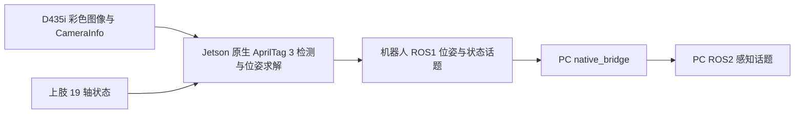

# WA1 头部相机 AprilTag 位姿

本目录是部署到 Jetson `~/csc309/perception/apriltag` 的 ROS1 感知代码。独立容器订阅头部 D435i 彩色图像，在 Jetson 本地识别 Tag36h11 的 ID 0，并发布相机光学系与上肢 API BASE 系下的位姿。PC 的 `native_bridge` 只转发位姿与状态，不传原始图像。



## 标定与坐标系

标签是 `Tag36h11 / ID 0`，`0.04 m` 指**检测到的黑框外边长**。相机位姿使用 `realsense_head_color_optical_frame`，即 x 向图像右、y 向图像下、z 向镜头前方；AprilTag 局部坐标系 x 向标签右、y 向标签上、z 指向观察者。输出的 `PoseStamped` 表示标签坐标系相对消息 `header.frame_id` 的位姿，时间戳沿用原始彩色图像。

[`calibration_vendor_run01.json`](csc309_apriltag_pose/config/calibration_vendor_run01.json) 固定了此前 `hand_eye/results/run01_latest.json` 中 `vendor_camera_info` 模型配套的相机内参、零畸变系数、`T_BASE_camera` 和标定时的颈部、腰部、升降关节位置。这里的 `wa1_upperlimb_base` 指上肢 API 使用的 BASE，不代表底盘 `base_link`。本版直接采用之前求出的外参；后续重标定时整组替换 JSON 中的内外参。

重新估计的焦距与 RealSense 原值相差约 1.7%，图像边缘畸变修正差异可达到十余像素，因此两套参数并非数值相同。此次选用厂商内参与其配套外参，是因为本次标定报告中该组模型的手眼留出误差更低。节点每次运行均核对相机帧名、1920×1080 分辨率、`plumb_bob` 模型、`K`、`D`、`R`、`P`；参数改变后须用对应模型重新求解外参。

`pose_base` 只有在 `Lifting_Z`、`Waist_Z`、`Waist_Y`、`Neck_Z`、`Neck_Y` 接近 JSON 中的标定位置时发布。旋转轴容差为 `0.002 rad`，升降容差为 `0.001 m`，关节反馈须在 `0.3 s` 内更新。标签离开画面、相机参数不符或姿态条件不满足时，位姿话题停止产生新消息，状态话题持续说明原因。

## ROS1 与 PC ROS2 接口

| Jetson ROS1 | PC ROS2 | 类型与含义 |
|---|---|---|
| `/csc309/apriltag/tag0/pose_camera` | `/perception/apriltag/tag0/pose_camera` | `geometry_msgs/PoseStamped`；标签相对彩色相机光学系的位姿。 |
| `/csc309/apriltag/tag0/pose_base` | `/perception/apriltag/tag0/pose_base` | `geometry_msgs/PoseStamped`；标签相对固定姿态下上肢 API BASE 的位姿。 |
| `/csc309/apriltag/tag0/detected` | `/perception/apriltag/tag0/detected` | `std_msgs/Bool`；这一帧是否识别到 ID 0。 |
| `/csc309/apriltag/tag0/base_valid` | `/perception/apriltag/tag0/base_valid` | `std_msgs/Bool`；这一帧是否发布 BASE 位姿。 |
| `/csc309/apriltag/tag0/status` | `/perception/apriltag/tag0/status` | `std_msgs/String` JSON；图像数、位姿数、单帧耗时、CameraInfo 检查与暂停原因，约 1 Hz。 |

检测采用官方 AprilTag 3 C 库的 Python 接口。彩色图像在 Jetson 转为灰度；默认将检测阶段降采样 2 倍，角点和位姿仍使用原图像像素坐标。单帧重投影均值超过 `5 px` 时不发布位姿。检测配置见 [`detector.yaml`](csc309_apriltag_pose/config/detector.yaml)。

## 首次部署和构建

Jetson 已有 `naviai_sensor` 镜像时，在 PC 的 `WA1_ws` 根目录执行以下复制命令。Jetson 上运行的是单独的 `csc309_apriltag` 容器，不更改 `naviai_sensor` 的部署文件。

```bash
ssh naviai@192.168.0.104 'mkdir -p ~/csc309/perception/apriltag/catkin_ws/src'
scp -r jetson/perception/apriltag/csc309_apriltag_pose \
  naviai@192.168.0.104:~/csc309/perception/apriltag/catkin_ws/src/
scp -r jetson/perception/apriltag/build.sh jetson/perception/apriltag/run.sh \
  jetson/perception/apriltag/test \
  naviai@192.168.0.104:~/csc309/perception/apriltag/
ssh naviai@192.168.0.104
cd ~/csc309/perception/apriltag
bash build.sh
```

`build.sh` 将 AprilTag 3 固定在 `b7c0ebe9`，通过现有传感器镜像编译独立的 `catkin_ws`。首次构建需要 Jetson 能访问上游源码；后续构建复用 `catkin_ws/src/apriltag`。构建产物在 `catkin_ws/install_isolated`。

可在 Jetson 运行离线检查，它会生成一张 ID 0 测试图，并检查检测、位姿、角点重投影和坐标变换：

```bash
docker run --rm --user "$(id -u):$(id -g)" -v "$PWD:/pipeline:ro" \
  --entrypoint /bin/bash 10.51.33.201:30002/navi_project/sensor:22CUDA_v1 -lc \
  'source /opt/ros/noetic/setup.bash; export PYTHONPATH="/pipeline/catkin_ws/install_isolated/lib/python3.10/site-packages:$PYTHONPATH"; export LD_LIBRARY_PATH="/pipeline/catkin_ws/install_isolated/lib:$LD_LIBRARY_PATH"; python3 /pipeline/test/offline_smoke.py'
```

完整的 ROS1 图像到位姿链路可用单独的本机 ROS Master 验证。它发布合成图像和标定姿态的模拟关节状态，检查相机位姿、BASE 变换、固定关节条件和标签离开画面后的状态；不会向真实机器人发布控制指令，也不会连接真实 ROS1 Master：

```bash
docker run --rm --network host --user "$(id -u):$(id -g)" -e HOME=/tmp \
  -v "$PWD:/pipeline:ro" -v "$PWD/catkin_ws:/work:ro" \
  --entrypoint /bin/bash 10.51.33.201:30002/navi_project/sensor:22CUDA_v1 -lc \
  'source /opt/ros/noetic/setup.bash; source /work/install_isolated/setup.bash; export PYTHONPATH="/work/install_isolated/lib/python3.10/site-packages:$PYTHONPATH"; export LD_LIBRARY_PATH="/work/install_isolated/lib:$LD_LIBRARY_PATH"; python3 /pipeline/test/isolated_ros_test.py'
```

## 真机启动、查看与停止

在 PC 终端登录 Jetson，进入已部署并构建的目录：

```bash
ssh naviai@192.168.0.104
cd ~/csc309/perception/apriltag
```

选择一种运行方式。前台运行会在当前终端持续显示识别日志：

```bash
bash run.sh
```

若要退出 SSH 后继续识别，改用后台运行：

```bash
bash run.sh --detach
docker logs -f csc309_apriltag
```

后台模式下，按 `Ctrl+C` 只会退出 `docker logs -f` 的日志查看。`run.sh` 使用 host 网络连接机器人 ROS1 Master，并按 Jetson 有线地址注册 ROS1 节点；若地址变化，在启动前设置 `WA1_JETSON_WIRED_IP` 和 `WA1_ROS1_MASTER_URI`。

在 Jetson 的另一个终端查看容器及识别状态：

```bash
docker ps --filter name=csc309_apriltag --format '{{.Names}} {{.Status}}'
docker exec csc309_apriltag bash -lc \
  'source /opt/ros/noetic/setup.bash; rostopic echo -n 1 /csc309/apriltag/tag0/status'
```

停止前台运行时，在启动它的终端按 `Ctrl+C`。停止后台运行时，在 Jetson 终端执行：

```bash
docker stop csc309_apriltag
docker ps --filter name=csc309_apriltag --format '{{.Names}} {{.Status}}'
```

最后一条命令没有输出，即表示识别容器已经停止。`run.sh` 启动容器时使用 `--rm`，因此停止后容器会自动删除。也可以直接从 PC 终端停止：

```bash
ssh naviai@192.168.0.104 'docker stop csc309_apriltag'
```

PC 端先构建含感知转发端点的桥镜像，启动桥，然后在查询终端加载 PC ROS2 环境：

```bash
python3 native_bridge/bridge.py build
python3 native_bridge/bridge.py start
export ROS_DOMAIN_ID=0
source native_bridge/setup_pc.bash
ros2 topic echo --once --qos-reliability best_effort \
  /perception/apriltag/tag0/status std_msgs/msg/String --full-length
ros2 topic echo --once --qos-reliability best_effort \
  /perception/apriltag/tag0/detected std_msgs/msg/Bool
ros2 topic echo --once --qos-reliability best_effort \
  /perception/apriltag/tag0/pose_camera geometry_msgs/msg/PoseStamped
ros2 topic echo --once --qos-reliability best_effort \
  /perception/apriltag/tag0/pose_base geometry_msgs/msg/PoseStamped
python3 jetson/perception/apriltag/test/pc_live_probe.py --seconds 6
```

已有旧桥容器时，先 `python3 native_bridge/bridge.py stop`，再运行 `start`。`pose_camera` 需要 ID 0 标签清晰出现在画面里；`pose_base` 还需要颈部、腰部和升降回到标定姿态。无标签时可先检查 `status` 中 `camera_info_ok=true`、`frame_age_ms` 持续更新，以及 `detected=false`。

`pc_live_probe.py` 只订阅 PC ROS2，统计两路位姿频率、按图像时间戳配对相机与 BASE 位姿、核对外参矩阵组合，并读取当前五个固定关节相对标定值的偏差。标签持续可见且固定关节条件满足时，脚本应返回退出码 `0`。

2026-11-02 的现场检查中，1920×1080 彩色图像下空场景检测约 `28 Hz`，`processing_ms` 约 `20 ms`；该数值是 Jetson 端图像回调耗时。

同日真实标签持续入镜、颈部/腰部/升降位于标定位置的 `6 s` 测试中，PC 收到相机和 BASE 位姿各 `156` 帧，按原始图像时间戳配对 `156` 帧，两路频率均为 `26.21 Hz`，`detected` 与 `base_valid` 的 true 比例均为 `100%`。相机位姿经固定外参重算后，与转发的 BASE 位姿最大位置差约 `5×10⁻¹⁶ m`、最大姿态角差约 `3×10⁻⁸ rad`。该结果验证消息与坐标变换链路；标签在 BASE 下的绝对精度还需已知位置的外部参照。
