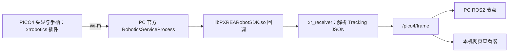

# pico4_ros2：PICO4 XR 数据接入

## 目的与范围

`pico4_ros2` 将 PICO4 VR 头显和双手柄的数据接入 PC 的 ROS2 Humble 工作空间。它提供原始设备帧、连接状态、JSONL 回放和本机浏览器位姿查看器，可独立用于输入设备开发与仿真。PICO4 是 VR 头显；机器人内部的 Pico 是另一台嵌入式设备。

## 数据链与工作原理



官方 PC Service 接收设备数据，`xr_receiver` 在运行时加载官方 SDK，并将 Tracking 回调转换为 `pico4_ros2/msg/XrFrame`。实测 SDK 回调的外层 JSON 包含 `functionName=Tracking`，`value` 是再次编码的 JSON；头显和手柄位姿为七个逗号分隔的数字。解析器同时支持七元素数组格式。

`XrFrame` 保留设备 ID、设备时间戳、PC 接收单调时钟时间、头显位姿、双手柄位姿及按键输入。ROS `header.stamp` 由 PC 填写，`header.frame_id` 为 `pico4_tracking`。消息中的七维位姿保留 SDK 原始值；查看器在显示层将其解释为位置 XYZ 与四元数 XYZW。SDK 未给出手柄跟踪状态时，`tracked_pose.status` 为 `-1`。

## 源码与 SDK

| 路径 | 作用 |
|---|---|
| [src/xr_receiver.cpp](src/xr_receiver.cpp) | 加载官方 SDK、接收回调、发布 ROS2 帧和连接状态；也支持 JSONL 回放。 |
| [src/xr_json_parser.cpp](src/xr_json_parser.cpp) | 解析官方 Tracking JSON 和手柄输入。 |
| [msg/](msg/) | `XrFrame`、`XrController`、`XrPose` 消息定义。 |
| [launch/](launch/) | 实时接入、回放和查看器三个启动入口。 |
| [scripts/pose_viewer.py](scripts/pose_viewer.py)、[web/](web/) | 本机 HTTP 服务与浏览器可视化界面。 |
| [scripts/viewer_math.py](scripts/viewer_math.py)、[config/pose_viewer.yaml](config/pose_viewer.yaml) | 显示坐标映射、姿态箭头和查看器参数。 |
| [test/](test/)、[test_data/](test_data/) | JSON 解析与坐标映射测试、合成回放数据。 |
| [vendor/](vendor/) | 官方 PC Service 安装包和原始消息定义对照文件。 |

当前官方安装包是 `vendor/XRoboToolkit-PC-Service_1.0.0.0_amd64.deb`，版本 `1.0.0.0`，SHA-256 为 `0904d3936f1da6187b86957ac85c69204672946cc56bd96a49316f36abd7951a`，适用于 x86_64 Linux。CMake 在构建时用 `dpkg-deb` 解包并安装运行文件；`xr_receiver` 通过 `dlopen` 加载其中的 SDK 库。

安装包由 Git LFS 跟踪。克隆仓库前安装 Git LFS；克隆后在工作空间根目录运行 `git lfs pull`，再构建本包。

## 编译

以下命令均在 `WA1_ws` 根目录执行。PC 环境使用 Ubuntu 22.04、ROS2 Humble、C++17、`libjsoncpp-dev`、`pkg-config` 和 `dpkg-deb`：

```bash
source /opt/ros/humble/setup.bash
colcon build --packages-select pico4_ros2
source install/setup.bash
```

使用其他本地 SDK 安装包时，以 `colcon build --packages-select pico4_ros2 --cmake-args -DPICO4_SDK_DEB=/absolute/path/to/SDK.deb` 编译。

## 实时启动、查看与关闭

终端 A 启动官方 PC Service 和 ROS2 接收节点：

```bash
source /opt/ros/humble/setup.bash
source install/setup.bash
ros2 launch pico4_ros2 pico4.launch.py
```

在 PICO4 的 `xrrobotics` 插件中填写 PC 的 Wi-Fi IP，连接 PC Service 并打开 **Send**。终端 B 加载同一 ROS2 工作空间后查看数据：

```bash
source /opt/ros/humble/setup.bash
source install/setup.bash
ros2 topic echo --once /pico4/status std_msgs/msg/String
ros2 topic echo --once --qos-reliability best_effort /pico4/frame pico4_ros2/msg/XrFrame
```

实时启动默认同时运行 PC Service 与 `xr_receiver`。已有独立运行的官方 PC Service 时，可使用 `start_vendor_service:=false`；使用 `publish_raw_json:=true` 时还会发布 `/pico4/raw_json`。在终端 A 按 `Ctrl+C` 关闭实时接入。

| ROS2 话题 | 类型 | 内容 |
|---|---|---|
| `/pico4/frame` | `pico4_ros2/msg/XrFrame` | 头显和双手柄位姿、按钮、摇杆、扳机、握键；BestEffort。 |
| `/pico4/status` | `std_msgs/msg/String` | JSON：`mode`、`sdk_initialized`、`server_connected`、`device_online`、`frames`、`parse_errors`、`last_frame_age_ms`；Reliable、TransientLocal。 |
| `/pico4/raw_json` | `std_msgs/msg/String` | 官方回调原文；由 `publish_raw_json:=true` 启用。 |

`sdk_initialized` 表示 SDK 已加载，`server_connected` 表示接收节点已连接本机 PC Service，`device_online`、`frames` 和 `last_frame_age_ms` 反映设备帧的更新情况。

## 浏览器位姿查看器

实时接入运行时，在另一个已加载工作空间、且 `ROS_DOMAIN_ID` 相同的终端启动；未设置时两端均使用默认 domain 0：

```bash
ros2 launch pico4_ros2 viewer.launch.py
```

浏览器打开 `http://127.0.0.1:8765`。`port:=8766` 可修改端口；在查看器终端按 `Ctrl+C` 关闭。页面显示头显和双手柄的位姿、局部坐标轴、轨迹，以及左右手柄的摇杆、按键、扳机和握键状态。页面可切换头显和世界坐标系，使用鼠标旋转、缩放、平移视角，并以当前头显位置重设显示原点。

查看器默认将 SDK 位姿坐标映射为显示坐标 **X 前、Y 左、Z 上**，在 [pose_viewer.yaml](config/pose_viewer.yaml) 中写作 `world = (-raw_z, -raw_x, raw_y)`。该映射已通过当前 PICO4 设备的逐轴观察核对。网页同时展示原始 XYZ 和 XYZW 数值；显示原点取首次收到的头显位置。

## JSONL 回放与测试

回放仓库中的合成样本时，终端 A 在 `WA1_ws` 根目录执行：

```bash
source /opt/ros/humble/setup.bash
source install/setup.bash
ROS_DOMAIN_ID=85 ros2 launch pico4_ros2 replay.launch.py \
  jsonl:="$PWD/src/pico4_ros2/test_data/sample_xr.jsonl" loop:=true rate_hz:=30
```

终端 B 使用相同的 domain 启动查看器：

```bash
source /opt/ros/humble/setup.bash
source install/setup.bash
ROS_DOMAIN_ID=85 ros2 launch pico4_ros2 viewer.launch.py
```

`sample_xr.jsonl` 使用实测 SDK 的 JSON 结构和合成位姿值。`replay.launch.py` 的 `jsonl`、`loop`、`rate_hz` 参数分别指定文件、循环模式和发布频率。两个终端各自按 `Ctrl+C` 结束。

源码自带 JSON 解析与查看器坐标映射测试：

```bash
colcon test --packages-select pico4_ros2
colcon test-result --test-result-base build/pico4_ros2 --verbose
```

实时 PICO4 接入、手柄按键和查看器方向已在当前设备上逐项核对。
